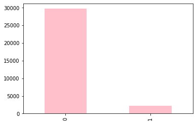
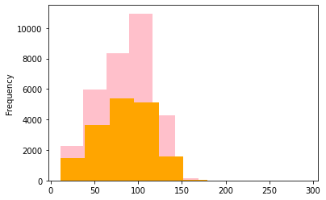
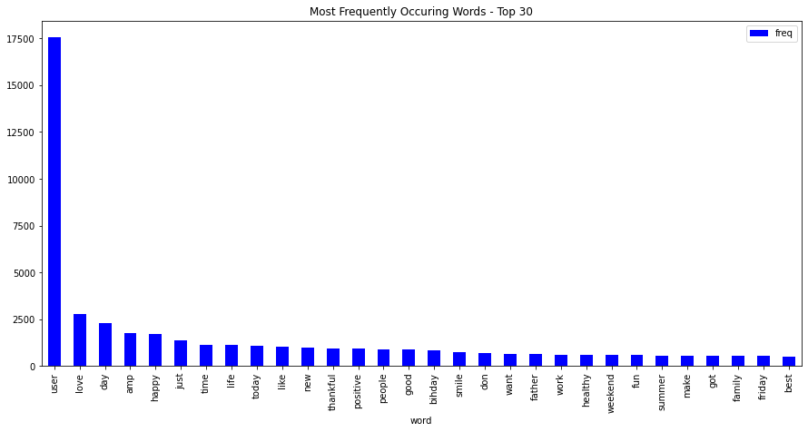

# Sentiment Analysis

**Detecting Racist and Sexist Tweets with Machine Learning**

## Overview

This project classifies tweets as hate speech (racist or sexist, label 1) or not (label 0). It cleans the tweet text, turns it into word-count features and compares a random forest with a decision tree. Because only 7% of tweets are hate speech, the project reports F1 score as well as accuracy.

## Repository layout

| Path | Content |
| --- | --- |
| `Sentiment Analysis.ipynb` | All code; every figure and table is produced here |
| `train_tweet.csv` | Labelled tweets used for training and validation |
| `test_tweets.csv` | Unlabelled tweets for prediction |
| `figures/` | Figures exported from the notebook |
| `flowchart.png`, `visualization.PNG` | Workflow and an overview of the visualisations |

## Dataset

| File | Rows | Columns |
| --- | --- | --- |
| `train_tweet.csv` | 31,962 tweets | id, label, tweet |
| `test_tweets.csv` | 17,197 tweets | id, tweet |

In the training file, 29,720 tweets are labelled 0 and 2,242 are labelled 1 (7.0%).

## How to run

1. Install the libraries: `pip install numpy pandas matplotlib seaborn scikit-learn nltk wordcloud`
2. In the second code cell, change the two file paths to `train_tweet.csv` and `test_tweets.csv`
3. Run all cells (the notebook downloads the NLTK stop-word list)

## Notebook structure

| Section | Content |
| --- | --- |
| Exploration | Class counts, tweet length by class, top 30 words, word clouds |
| Cleaning | Keep letters only, lower-case, remove English stop words, Porter stemming |
| Features | Bag of words with the 2,500 most frequent terms, standard scaling |
| Split | 75% training (23,971 tweets), 25% validation (7,991 tweets), `random_state=42` |
| Models | Random forest and decision tree, scored with accuracy, F1 and a confusion matrix |

## Key results

| Model | Validation accuracy | F1 (hate speech) | Hate tweets caught |
| --- | --- | --- | --- |
| Random forest | 95.3% | 0.619 | 304 of 559 |
| Decision tree | 93.2% | 0.536 | 312 of 559 |
| Always predict "not hate" | 93.0% | 0 | 0 of 559 |

The random forest has the best F1. Accuracy alone is misleading here: always predicting "not hate" already scores 93.0%. Both models score 99.9% on the training data, so they overfit, and better features (for example TF-IDF or word embeddings) would be the next step.

## Results in figures

**The classes are heavily imbalanced**: about 13 non-hate tweets for every hate tweet.

**Tweet lengths overlap between the classes**, so length alone cannot separate them.

**"user" is the most common token** because every @-mention is replaced by `@user` in the data.

